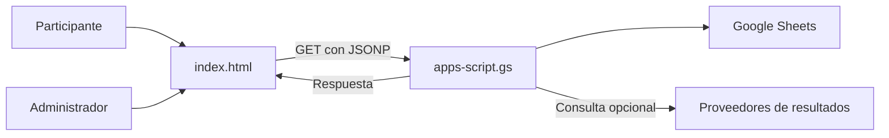

# La Polla Mundialera 2026

Aplicación web para organizar pronósticos de fútbol entre amigos. Combina un frontend HTML/CSS/JavaScript con Google Apps Script y Google Sheets.

## Empieza aquí

- [Mapa visual, arquitectura y recorrido de los datos](docs/MAPA.md).
- [Revisión documental y pendientes](docs/REVISION.md).

> Revisión documental: 26 de octubre de 2026. La presencia de código no acredita despliegue ni pruebas aprobadas. Esta revisión no cambia lógica, datos ni configuración operativa.

## Qué hay en este repositorio

| Archivo | Para qué sirve |
|---|---|
| `index.html` | Interfaz, pronósticos, administración, simulación y cálculo visible de puntajes. |
| `apps-script.gs` | Acceso a Sheets, lectura/escritura y sincronización con proveedores externos. |
| `MANUAL.md` | Instrucciones de despliegue existentes; contrastar con la versión actual antes de usarlas. |
| `sw.js` | Service worker; comportamiento no auditado en esta revisión. |
| `grafica-wsp.html`, `render-grafica.js` | Recursos de gráfica; no ejecutados en esta revisión. |
| `polla-mundialera-2026.png` | Recurso gráfico. |

## Arquitectura en un vistazo

**Lectura textual:** el navegador presenta la app; Apps Script conecta con la planilla y los proveedores. Los datos operativos de Sheets no están respaldados automáticamente por versionar el código en GitHub.

## Puntajes: leer antes de modificar

El frontend actual calcula el total mediante `calcPtsTotal()` sumando grupos, marcadores KO, partidos y correcciones configuradas. El backend conserva `calcularScores()` con otra composición. **No se ha comprobado equivalencia entre ambos.**

El antiguo README describía un sistema por rondas y un máximo de 300 puntos que no representan de forma fiable el cálculo visible actual. Se conserva íntegro en [README anterior](docs/README-ANTERIOR.md), como referencia histórica, no como reglamento vigente.

Antes de una nueva edición del torneo: acordar un reglamento único, crear ejemplos de prueba y contrastar frontend, backend y datos reales. Esta revisión no altera puntajes ni pronósticos.

## Preparación y uso

1. Trabajar con una copia de prueba de Google Sheets, nunca con participantes reales para experimentar.
2. Revisar `MANUAL.md` y la configuración del script vinculado a la planilla.
3. Configurar proveedores y credenciales únicamente en entornos privados; la cobertura de una competición depende del proveedor y del plan.
4. Revisar la autenticación del backend **antes** de publicar una Web App accesible a cualquiera.
5. Publicar el frontend estático solo después de validar el flujo con la copia de prueba.

La dirección histórica del frontend es [GitHub Pages](https://tingado.github.io/PollaMundial2026/). Su disponibilidad y el despliegue del backend no fueron comprobados en esta revisión.

## Seguridad y límites

- El PIN incrustado en el frontend no sustituye una autorización del servidor.
- El enrutador `doGet()` expone acciones de escritura y administración sin una comprobación de autorización visible en ese punto. Revisar la protección efectiva de toda la operación antes de usar datos reales.
- No transportar secretos mediante URLs: pueden quedar en registros e historial. Revisar el flujo existente de guardado de tokens.
- No se ejecutaron Apps Script, sincronizaciones, borrados ni acciones administrativas.

## Cómo continuar

Consulta [MAPA](docs/MAPA.md) para entender funciones y relaciones; [REVISION](docs/REVISION.md) distingue hallazgos, propuestas y verificaciones pendientes. No hay garantía de costo cero: aplican cuotas, planes y condiciones de los servicios externos.
