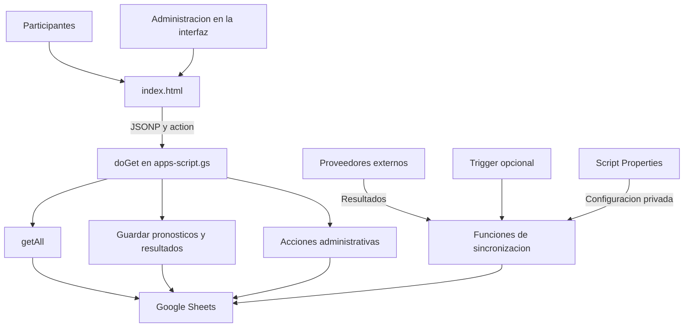
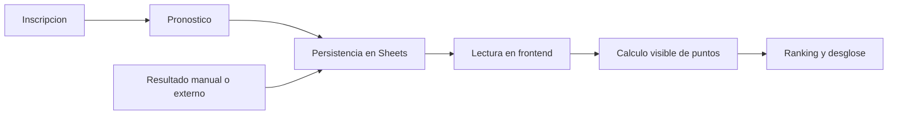
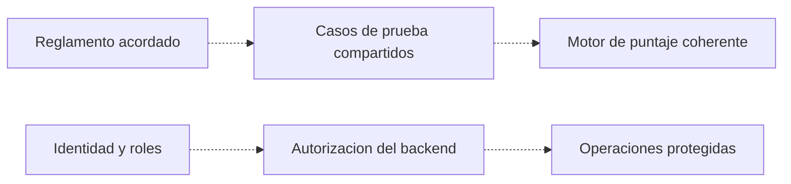

# Mapa del proyecto — Polla Mundialera

[Volver al README](../README.md) · [Revisión](REVISION.md)

## 1. Qué resuelve

Organizar participantes, pronósticos, resultados y clasificación de una polla de fútbol. La interfaz y el backend se versionan aquí; la información de la planilla y los secretos del servicio son recursos separados.

## 2. Grafo de componentes observados

**En palabras:** la aplicación pide información y guarda cambios por el mismo enrutador. Sheets conserva registros; los triggers pueden actualizar resultados sin que una persona mantenga el navegador abierto. La protección de las operaciones no debe depender de ocultar botones.

## 3. Flujo funcional

## 4. Mapa de funciones para quien mantenga el código

| Necesidad | Punto de entrada observado |
|---|---|
| Consultar estado | Backend `doGet()` → `getAll()` |
| Guardar selección de grupos | `guardarPron()` y acciones relacionadas |
| Guardar marcadores eliminatorios | `guardarKO()` / `guardarResultadosKO()` |
| Automatizar resultados | `activarAutoSync()` y funciones de proveedor |
| Total mostrado | Frontend `calcPtsTotal()` / `calcPtsDetalle()` |
| Grupos | `calcPtsGrupos()` |
| Marcadores | `calcPtsPartidos()` / `calcPtsKO()` |
| Correcciones configuradas | `getScoreCorrection()` |
| Cálculo histórico del backend | `calcularScores()` |

## 5. Contradicción de puntajes: no ocultarla

El total del frontend suma grupos, KO, partidos y correcciones. En cambio, `calcularScores()` del backend suma posiciones de grupo y aciertos por equipos/rondas. El código y sus comentarios también difieren en algunos criterios; esta documentación toma como evidencia las funciones, no declara un reglamento aprobado.

En KO, `calcPtsKOPartido()` evalúa goles y tendencia; la rama `aet` tiene tratamiento propio. No debe resumirse como «siempre solo dos puntos» sin verificar la función. El antiguo máximo de 300 puntos se retira de la documentación vigente, no del código ni de los datos.

## 6. Propuesta de mejora — no implementada

Las flechas discontinuas representan trabajo pendiente. No se cambió el motor ni se desplegó autenticación.

## 7. Cómo validar sin afectar la polla real

- Crear una copia de la planilla con participantes ficticios.
- Probar grupo, marcador, empate, alargue/penales y ausencia de resultados.
- Contrastar desglose visible con resultados calculados esperados y backend.
- Verificar que un usuario sin permisos no puede cambiar resultados ni ejecutar acciones administrativas.
- Comprobar restauración de una copia antes de ensayar migraciones.

No se ejecutaron estas pruebas. Los diagramas describen la lectura estática, no una certificación de operación o seguridad.
